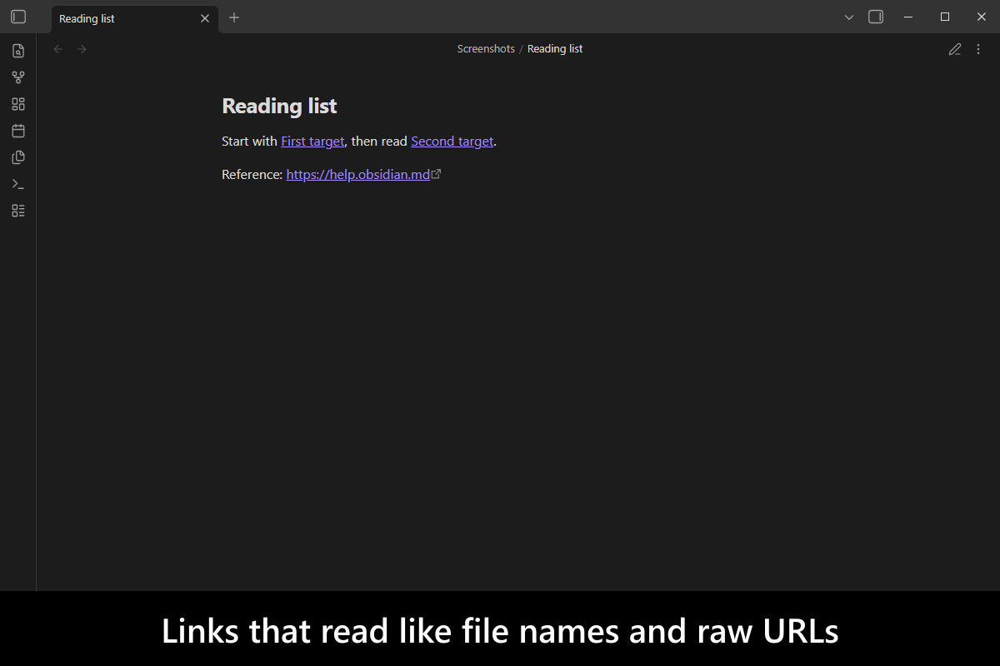
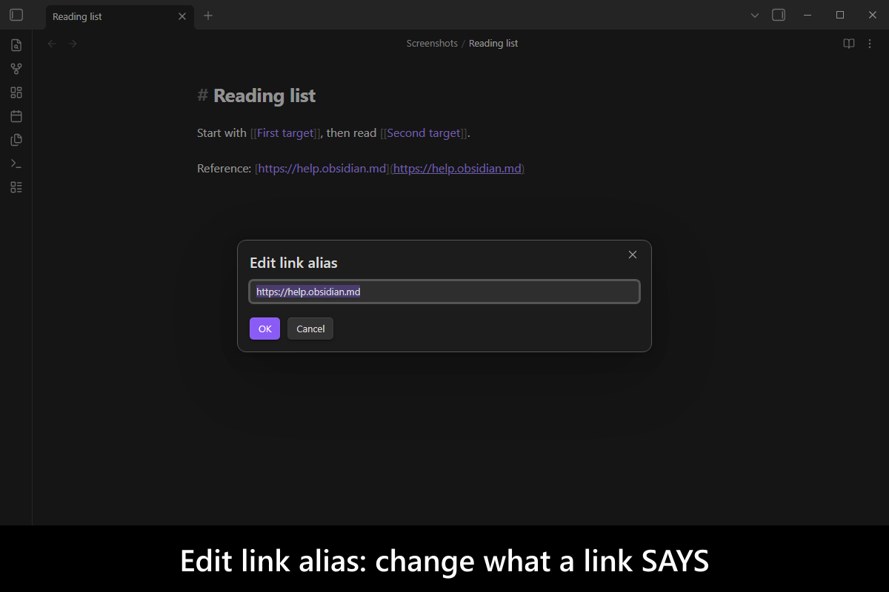
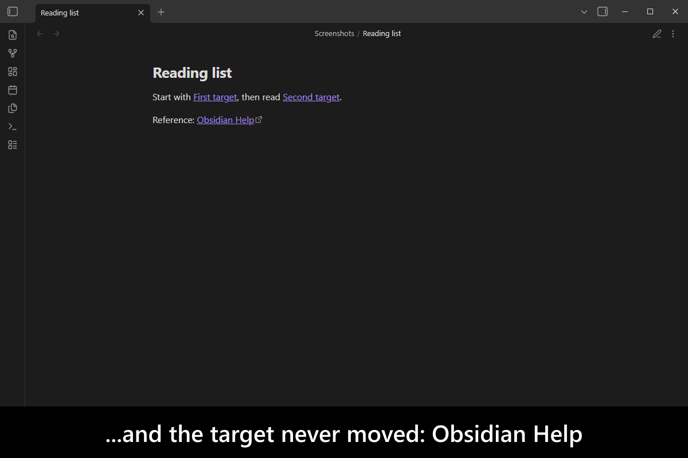
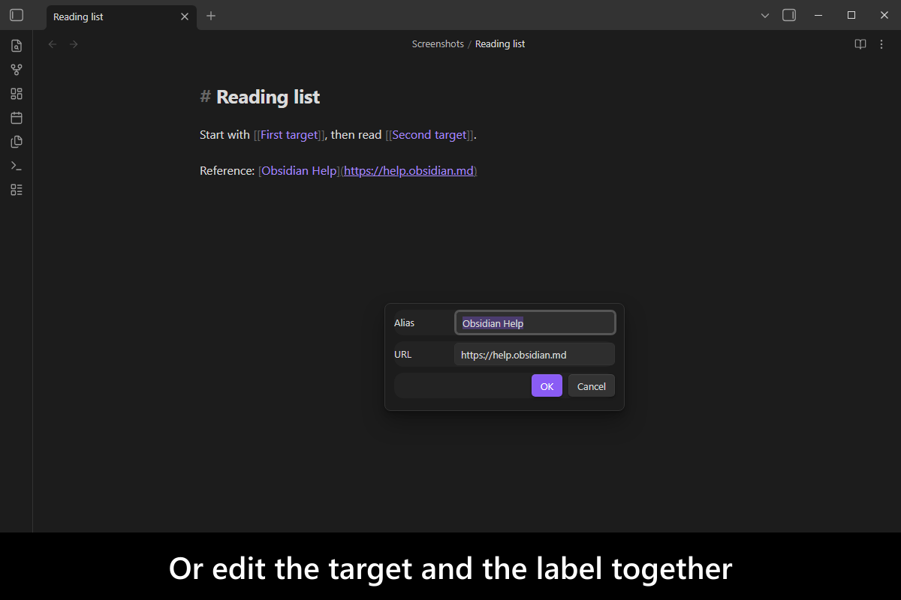
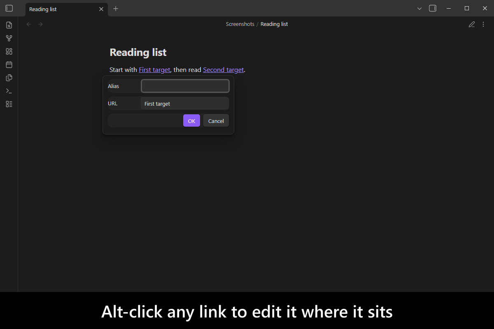
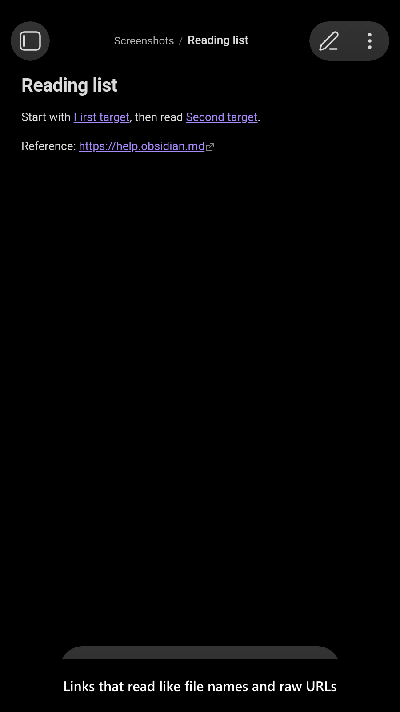
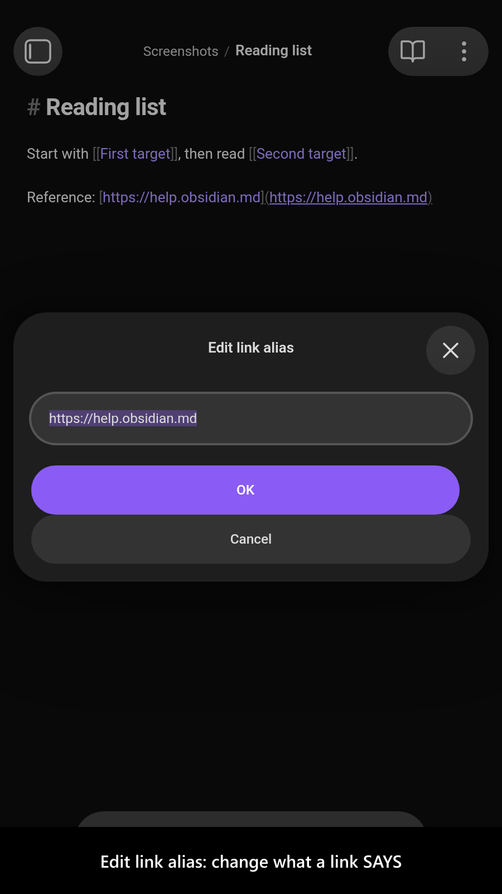
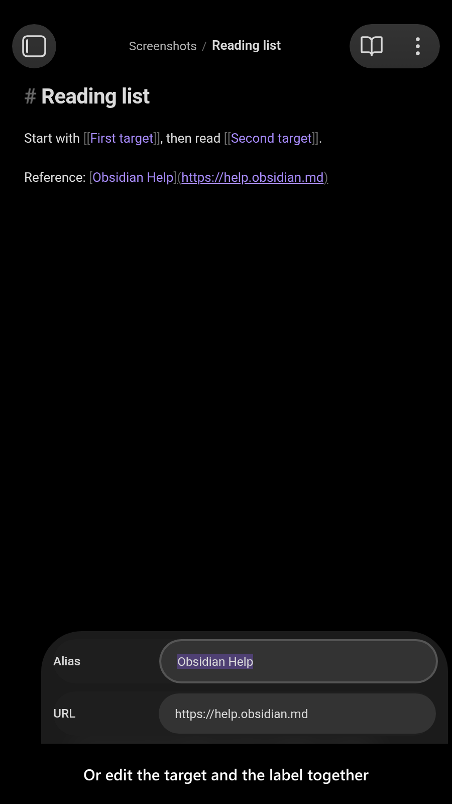
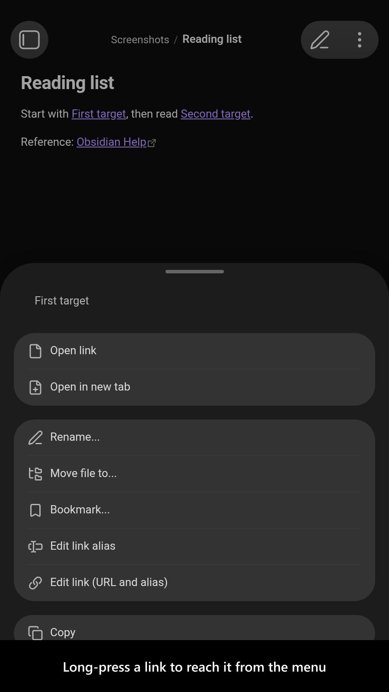

# Edit Link Alias

   

Changing what a link *says* in [Obsidian](https://obsidian.md/) means editing the raw link text by hand — finding the `|` in a wikilink or the right pair of brackets in a markdown link, in the middle of a sentence, without breaking either. In Reading view you cannot do it at all without switching modes.

This plugin edits the link under your cursor through a small pop-up: **Edit link alias** changes just the display text, and **Edit link (URL and alias)** changes the target and the text together. Both work on wikilinks, markdown links, external links and links in a note's properties, from the Command Palette, the right-click menu, or `Alt` + clicking the link itself.

<!-- markdownlint-disable MD033 -->

More screenshots

<!-- markdownlint-enable MD033 -->

## Demo vault

**The documentation is a demo vault.** Every feature has a note that explains what it does and why you would want it, with links of every kind already in place to edit.

**[Start reading here](<./demo-vault/00 Start.md>)** — it is plain markdown, so it works on GitHub with nothing installed.

A copy of the vault ships with every release. You can access it via any of the following:

1. Running the **`Edit Link Alias`: Open demo vault** command.
2. Downloading `edit-link-alias-demo-vault.zip` from the [Releases](https://github.com/mnaoumov/obsidian-edit-link-alias/releases). It unzips into a single `edit-link-alias-demo-vault-<version>` folder.
3. Browsing its source in [`demo-vault/`](./demo-vault/README.md) in this repository.

## What it does

- **Edit a link's display text** without hunting for the `|` or the brackets. [01 Edit link alias](<./demo-vault/01 Edit link alias.md>)
- **Edit the target and the text together**, in one two-field pop-up. [03 Edit link URL and alias](<./demo-vault/03 Edit link URL and alias.md>)
- **`Alt` + click a link to edit it** — in Reading view, Live Preview and source mode, on desktop and mobile. It opens on the alias with the text selected, since that is the more common edit, and `Tab` moves to the URL. `Alt` + click is used because Obsidian gives it no meaning on a link, so nothing you already do changes. [04 Alt click a link to edit it](<./demo-vault/04 Alt click a link to edit it.md>)
- **External links** work the same way, including an address written without `https://`, such as `www.example.com`. [02 External links](<./demo-vault/02 External links.md>)
- **Links in properties** are editable too, written back through the frontmatter so the value stays valid YAML — with the two consequences that follow from that. That includes a link shown in a **Base**, which is written to the note in its row. [05 Frontmatter links](<./demo-vault/05 Frontmatter links.md>)

## Similar plugins

- [`Better Links`](https://community.obsidian.md/plugins/better-links) — a plain click on a link in the Markdown editor opens a pop-up for its text and target, with quick actions to open, copy or delete the link and suggestions for internal targets; this plugin keeps the plain click as navigation, opens on `Alt` + click, and also edits links in Reading view and in properties.
- [`Better Link Clicker`](https://community.obsidian.md/plugins/better-link-clicker) — a plain click on a link in Live Preview places the cursor in the raw link text instead of following it, and asks before a click creates a missing note; this plugin edits the alias and URL through a pop-up instead of in the raw text.
- [`MM Clean Links`](https://community.obsidian.md/plugins/mm-clean-links) — a click on a link in Live Preview places the cursor and a double-click selects the bracketed text, and it can reformat the capitalization of external link titles; this plugin edits a link through a pop-up and does no title formatting.
- [`F2 Quick Rename`](https://community.obsidian.md/plugins/ftwo-quick-rename) — `F2` renames the current note or the embed or link under the cursor, editing an embed's alias or an external link's URL and title, and opens a panel for the note's properties; this plugin edits the display text and target of any link without renaming files.

Last searched for similar plugins on 2026-10-26.

## Installation

The plugin is available in [the official Community Plugins repository](https://community.obsidian.md/plugins/edit-link-alias).

### Beta versions

To install the latest beta release of this plugin (regardless if it is available in [the official Community Plugins repository](https://community.obsidian.md) or not), follow these steps:

1. Ensure you have the [BRAT plugin](https://community.obsidian.md/plugins/obsidian42-brat) installed and enabled.
2. Click [Install via BRAT](https://intradeus.github.io/http-protocol-redirector?r=obsidian://brat?plugin=https://github.com/mnaoumov/obsidian-edit-link-alias).
3. An Obsidian pop-up window should appear. In the window, click the `Add plugin` button once and wait a few seconds for the plugin to install.

## Debugging

By default, debug messages for this plugin (id: `edit-link-alias`) are hidden.

If you need to enable them refer to the [documentation](https://mnaoumov.dev/obsidian-lib/guides/debugging/).

## Changelog

All notable changes to this project will be documented in the [CHANGELOG](./CHANGELOG.md).

## Contributing

Contributions are welcome — see [CONTRIBUTING](./CONTRIBUTING.md) to get set up.

## Support

<!-- markdownlint-disable MD033 -->

<!-- markdownlint-enable MD033 -->

## My other Obsidian resources

[See my other Obsidian resources](https://github.com/mnaoumov/obsidian-resources).

## License

© [Michael Naumov](https://github.com/mnaoumov/)
